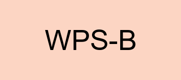

# wps_dispimg.xlsx

- source: `examples\wps_dispimg.xlsx`
- converted: 2026-11-15T22:38:29
- sheets: 1

## Sheet 1: BOM

- state: visible
- used range: A1:C4
- images: 2

| # | A | B | C |
|---|---|---|---|
| 1 | Item | Picture | Spec |
| 2 | Bracket |  | SUS304 |
| 3 | Spring |  | 0.5 mm wire |
| 4 | Ghost | [image missing: ID_NOPE] | picture missing on purpose |
